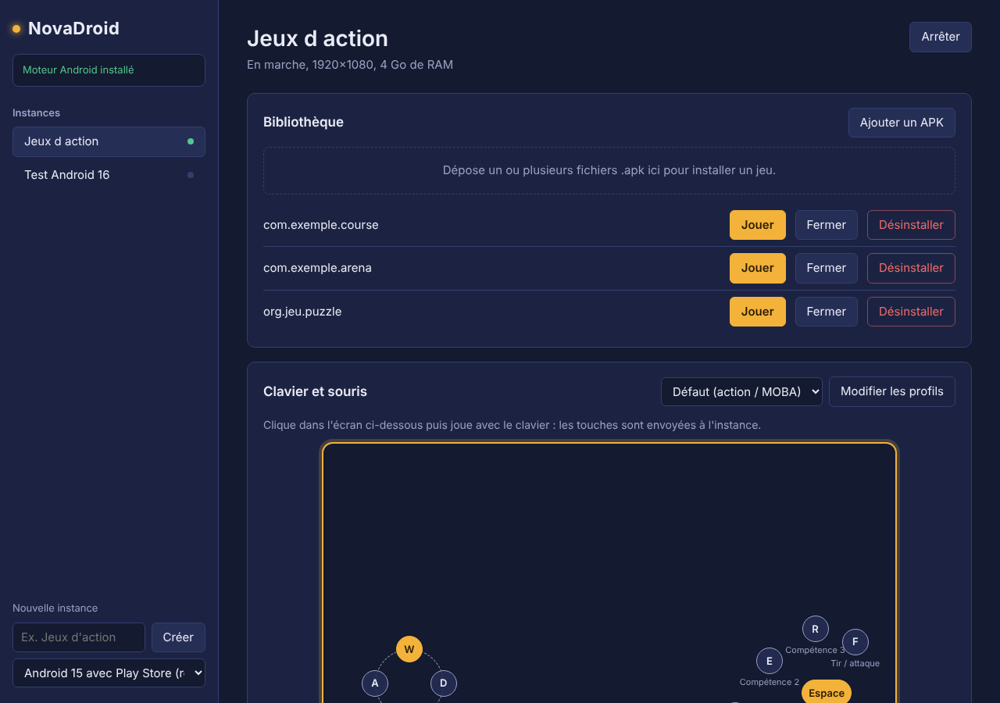

# NovaDroid

Lanceur de jeux Android pour PC (Windows en priorité, Linux et macOS aussi). NovaDroid ne
réinvente pas l'émulation : il pilote l'**émulateur Android officiel open source** (basé sur
QEMU) avec les images système Android 15/16, et ajoute par-dessus une interface pensée pour
les jeux.



## Ce que fait le prototype

- Installe tout seul le moteur Android (outils du SDK, émulateur, ADB, image système).
- Crée plusieurs **instances** (téléphones virtuels) avec leurs réglages : RAM, cœurs CPU,
  résolution en paysage, stockage.
- Lance les instances avec l'**accélération matérielle** (WHPX / Hyper-V sous Windows, KVM
  sous Linux, HVF sous macOS) et le **rendu GPU de l'hôte** (Vulkan / OpenGL).
- Installe un jeu par **glisser-déposer d'APK** (APK simples ou en plusieurs morceaux).
- Liste, lance, ferme et désinstalle les jeux.
- **Clavier et souris** : profils de touches en JSON (joystick ZQSD/WASD, appuis, appuis
  maintenus, touches Android). Les touches sont envoyées à l'instance via un shell ADB
  persistant pour limiter la latence.

## Prérequis (Windows)

1. Windows 10 ou 11, 64 bits, 16 Go de RAM conseillés, ~10 Go d'espace libre.
2. Virtualisation activée dans le BIOS (Intel VT-x ou AMD-V).
3. Dans « Activer ou désactiver des fonctionnalités Windows », cocher
   **Plateforme de l'hyperviseur Windows**, puis redémarrer.
4. [Node.js 22](https://nodejs.org) ou plus récent.

## Lancer

```bash
npm install
npm start          # compile et ouvre l'application
npm test           # tests du cœur
npm run doctor     # diagnostic (SDK, accélération, instances)
```

Au premier lancement, clique sur **Installer le moteur Android** (environ 3 Go), crée une
instance, démarre-la, puis dépose un APK dans la bibliothèque.

Les données sont dans `%LOCALAPPDATA%\NovaDroid` (Windows) ou `~/.local/share/novadroid`
(Linux). La variable `NOVADROID_HOME` permet de changer cet emplacement.

## Profils de touches

Les profils sont des fichiers `.json` dans le dossier `keymaps` des données (bouton
« Modifier les profils »). Les coordonnées vont de 0 à 1 (fraction de l'écran) :

```json
{
  "name": "Mon jeu de course",
  "bindings": [
    { "action": "hold", "label": "Accélérer", "key": "ArrowUp", "x": 0.9, "y": 0.8 },
    { "action": "tap", "label": "Nitro", "key": "Space", "x": 0.75, "y": 0.85 },
    { "action": "keyevent", "label": "Retour", "key": "Escape", "code": "KEYCODE_BACK" }
  ]
}
```

Actions : `tap`, `hold` (maintenu), `keyevent` (touche Android), `joystick`
(`up`/`down`/`left`/`right`, `x`, `y`, `radius`). Les touches utilisent les codes
`KeyboardEvent.code` (`KeyW`, `Space`, `ArrowUp`…).

## Architecture

```
src/core/       logique sans interface, testée
  sdk.ts        emplacements, paquets, URL des outils
  installer.ts  téléchargement et installation du SDK
  instances.ts  création et réglages des appareils virtuels (AVD)
  emulator.ts   lancement de l'émulateur, ports, accélération
  adb.ts        APK, jeux, entrées
  keymap.ts     moteur de mapping clavier -> tactile
src/main/       processus Electron et pont IPC sécurisé
src/renderer/   interface
keymaps/        profils fournis
```

## Limites connues et suite

- Le jeu s'affiche dans la fenêtre de l'émulateur, et les touches se tapent dans la zone de
  contrôle de NovaDroid. Prochaine étape : **affichage intégré** dans NovaDroid via le flux
  gRPC de l'émulateur, avec la superposition des touches directement sur le jeu.
- Un seul doigt virtuel à la fois (limite de `input motionevent`) : le joystick et un appui
  maintenu ne se cumulent pas encore. Le multitouch viendra avec le contrôle gRPC.
- Souris en mode visée (FPS) pas encore gérée.
- Les images « Play Store » contiennent les services Google (propriétaires) ; choisis
  « AOSP » pour un système 100 % open source.
- Installeur Windows (.exe) à ajouter (electron-builder).
